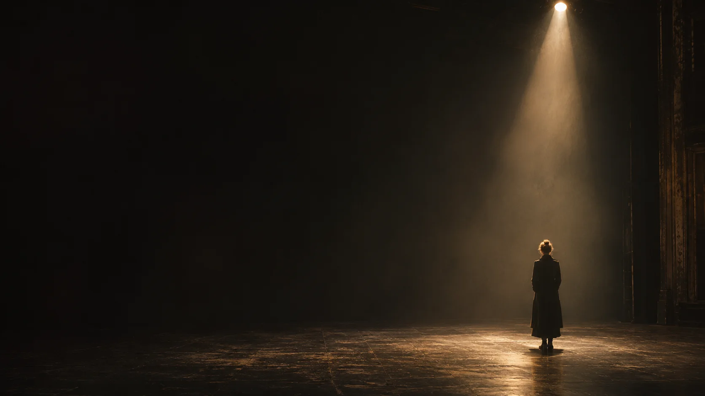

# По ту сторону кадра

**Искусство видеть то, что скрыто.**

Интерактивный кинематографический проект о композиции, эмоциях и свете. Посетитель проходит шесть глав, исследует язык кино и создаёт свой режиссёрский этюд. Автор проекта — **БЕЙСЕМБИНА АЛИЗА**, группа **Р-26-02**, 2026. Разработка и оригинальные визуальные материалы подготовлены с использованием ChatGPT и OpenAI Codex.

Интерфейс прошёл визуальную переработку: умеренные скругления, сегментированные настройки с пружинным движением, плавная смена кадров и более выразительная типографика. Архитектура и все функции сохранены.



## Запуск

Используйте Node.js 24 LTS и npm. В проекте есть `package-lock.json`.

```sh
npm ci
npm run dev
```

Откройте адрес, напечатанный Vite, обычно **http://127.0.0.1:5173/aliza/**. Проект настроен на GitHub Pages с базовым путём `/aliza/` в development и production. Сайт работает без регистрации, базы данных, ключей API и внешнего сервера приложений. Изображения, шрифты и звук не требуют внешних сервисов во время просмотра.

Проверка готовой сборки:

```sh
npm run build
npm run preview
```

Адрес Vite preview: **http://127.0.0.1:4173/aliza/**. Для проверки в условиях статического хостинга без SPA-fallback используйте `npm run preview:pages` и адрес **http://127.0.0.1:5174/aliza/**. Этот сервер возвращает настоящие 404 для отсутствующих ресурсов и обращений к корню домена вместо каталога проекта.

Не открывайте `dist/index.html` через `file://`: для ES-модулей и локальных ресурсов нужен HTTP-сервер, например `npm run preview`.

## Что можно исследовать

| Глава                 | Возможности                                                                                                                                                           |
| --------------------- | --------------------------------------------------------------------------------------------------------------------------------------------------------------------- |
| 00 / Пролог           | Театральный свет, конечная портретная последовательность, ручной выбор кадра, начало просмотра и пропуск вступления.                                                  |
| 01 / Искусство видеть | Четыре отдельных подготовленных фотографии для общего, среднего, крупного плана и детали. Сетка третей, объяснение эмоционального эффекта и режиссёрского применения. |
| 02 / Анатомия эмоций  | Пять эпизодов с Ализой: страх, радость, одиночество, любовь и надежда. Меняются фотография, атмосфера и заметка.                                                      |
| 03 / Свет меняет всё  | Одна комната в четырёх световых состояниях. Сравнение двух режимов перетаскиванием, касанием, стрелками клавиатуры и кнопками.                                        |
| 04 / Лаборатория      | Пять окружений, жанр, свет, план, настроение и композиция. Изменения видны в Canvas; описание зависит от всех выбранных параметров.                                   |
| 05 / Финальные титры  | Чёрно-белый портрет автора, конечная анимация с паузой, повтор путешествия и переход к новой сцене.                                                                   |

Лаборатория умеет создавать постер, возвращаться к редактированию, выбирать случайный вариант, сбрасывать настройки, показывать кадр без интерфейса, экспортировать **настоящий PNG 1600 × 1320** и создавать ссылку, которая восстанавливает все настройки. Экспорт использует тот же рендерер, что и предпросмотр; внизу PNG добавляются название, параметры и режиссёрское описание.

На телефоне монитор лаборатории остаётся над настройками. Есть полноэкранное меню с управлением фокусом, индикаторы главы и общего прогресса, поддержка клавиатуры, `prefers-reduced-motion` и безопасных отступов экрана. Атмосферный звук синтезируется через Web Audio, изначально выключен и имеет регулировку громкости. При скрытии вкладки он затихает.

## Визуальные материалы и персонализация

В `public/media` хранятся 12 оригинальных сгенерированных фотографий в WebP, их варианты шириной 768 px и отдельный чёрно-белый производный портрет. Общий объём этой папки — около 1,1 МБ. Подготовлены собственный favicon и изображение для социальных сетей.

- Ализа появляется в портретном кадре пролога, пяти эмоциональных эпизодах, отдельном окружении лаборатории и финальных титрах.
- Для новых портретов использованы предоставленные референсы, длинные светлые волосы, затемнённые корни и пирсинг носа. Окончательная оценка узнаваемости остаётся за Ализой.
- Самостоятельный мир проекта составляют театр, закулисный коридор, улица после дождя, комната с окном, анонимный актёрский этюд и деталь руки. Анонимная актриса в главе о планах не обозначается как Ализа.
- Личные исходные фотографии не скопированы в проект и не входят в сборку или Git. Рабочие сгенерированные PNG находятся в игнорируемой `.asset-sources/`; браузер использует только оптимизированные результаты.

Уже подготовленные WebP включены в проект, поэтому для установки и сборки генератор изображений не нужен. Скрипт `node scripts/prepare-media.mjs` нужен только при повторной обработке собственных PNG в локальной `.asset-sources/` с теми же именами. Он также создаёт монохромный портрет и обложку.

## Технологии и структура

React, TypeScript со строгой проверкой, Vite, Tailwind CSS 4, CSS Custom Properties, GSAP и ScrollTrigger, Lucide React, Canvas 2D и Web Audio. Локальные вариативные шрифты Manrope и Unbounded поддерживают кириллицу. Серверная часть и платные API не используются.

```text
src/
  app/                       сборка приложения и переходы между главами
  chapters/                  шесть самостоятельных глав
  components/laboratory/     панель настроек, окружения и постер
  components/                навигация, изображения, Canvas, курсор
  config/project.ts          имя автора, год и список глав
  data/cinema.ts             тексты и учебные визуальные эпизоды
  hooks/                     анимации, прогресс и звуковая атмосфера
  lib/scene.ts               типы, параметры URL, описания сцены
  lib/renderer.ts            единый рендер предпросмотра и PNG
  lib/assets.ts              пути публичных ресурсов через Vite BASE_URL
  styles/global.css          дизайн-система и адаптивные композиции
public/                      локальные ресурсы, метаданные, robots.txt
tests/                       функциональные и адаптивные проверки
docs/                        отчёт, скриншоты и лицензии шрифтов
.github/workflows/deploy.yml  сборка, тесты и публикация GitHub Pages
```

Данные автора редактируются в `src/config/project.ts`. Изображения и тексты эпизодов — в `src/data/cinema.ts`. Параметры сцены проверяются при чтении URL; неизвестные и некорректные значения заменяются значениями по умолчанию. Отрисовка невидимых Canvas откладывается, изображения ниже первого экрана загружаются лениво. Таймлайны и обработчики очищаются при размонтировании, включая React Strict Mode.

## Проверки

```sh
npm run typecheck
npm run build
npm test
```

Playwright по умолчанию использует установленный Microsoft Edge, как в среде разработки. На другом компьютере можно установить Chromium:

```sh
npx playwright install chromium
```

Затем в PowerShell:

```powershell
$env:PLAYWRIGHT_CHANNEL = 'chromium'
npm test
```

В macOS/Linux: `PLAYWRIGHT_CHANNEL=chromium npm test`. Перед тестами выполните сборку. Playwright сам запустит строгий статический preview на порту 5174 и проверит сайт по адресу `/aliza/`. Если порт занят, задайте `PAGES_PREVIEW_PORT` перед запуском тестов.

Набор проверяет все главы, изображения и ошибки браузера, диалог и возврат фокуса, планы, эмоции, рендер каждого параметра, сравнение света, сенсорное управление, экспорт PNG, восстановление URL, постер, случайный вариант, сброс, звук и уменьшенную анимацию. Контрольные ширины: **320, 375, 390, 430, 768, 1024, 1440 и 1920 px**. Axe проверяет WCAG A/AA на основной странице, в меню и в режиме постера. Это автоматическая проверка, она не заменяет ручную проверку на реальных устройствах.

Результаты и ограничения описаны в [отчёте подготовки Pages](docs/GITHUB_PAGES.md). Диагностические скриншоты и отчёты остаются локально и исключены из Git. HTML-отчёт Playwright открывается командой `npx playwright show-report` после тестов.

Для подготовки GitHub Pages выполнено **30 / 30 проверок**: дополнительно проверены все собранные изображения, шрифты, CSS/JS, отсутствие запросов ресурсов за пределами префикса, ссылки сцен после перезагрузки и финальные титры. [Отчёт о подготовке GitHub Pages](docs/GITHUB_PAGES.md).

## Публикация на GitHub Pages

Используется существующий публичный репозиторий **[bekishkakish/aliza](https://github.com/bekishkakish/aliza)**. Адрес сайта: **https://bekishkakish.github.io/aliza/**. Состояние публикации видно во вкладке Actions и окружении github-pages.

Когда решите публиковать:

1. Откройте существующий репозиторий `bekishkakish/aliza`. Создавать новый не нужно.
2. Выполните `git init -b main`, если локальный репозиторий ещё не создан.
3. Выполните `git add .`, затем проверьте `git status --short` и `git diff --cached --name-only`. `.asset-sources`, `node_modules`, `dist`, `.env*`, приватные папки, личные исходные фотографии и результаты тестов исключены через `.gitignore`.
4. Выполните `git commit -m "Prepare Beyond the Frame for GitHub Pages"`.
5. В GitHub откройте **Settings → Pages → Build and deployment → Source → GitHub Actions**. Если настройка недоступна в пустом репозитории, выберите её после первого push и затем запустите workflow вручную.
6. Добавьте адрес своего репозитория: `git remote add origin https://github.com/bekishkakish/aliza.git`. Если `origin` уже существует, проверьте его командой `git remote -v`.
7. Выполните `git push -u origin main`. **Push в `main` запускает автоматическую публикацию**, когда GitHub Pages включён.
8. Откройте **Actions → Deploy to GitHub Pages**. Дождитесь завершения `build` и `deploy`; итоговый адрес будет указан в окружении `github-pages`.

Workflow `.github/workflows/deploy.yml` использует Node.js из `.nvmrc` (24), выполняет `npm ci`, production build со строгой проверкой TypeScript, устанавливает Chromium и запускает все тесты на пути проекта. В Pages передаётся **только `dist`**, затем отдельный job публикует проверенный артефакт. Ветка `gh-pages`, ручная загрузка `dist` и персональный токен не нужны. Есть ручной запуск **Actions → Deploy to GitHub Pages → Run workflow** для ветки `main`. Изменения в `main` после публикации будут запускать следующие деплои.

Не добавляйте исходные личные фотографии, `.asset-sources`, ключи и рабочие файлы с персональными данными. Публичная папка содержит только подготовленные ресурсы сайта; скриншоты демонстрируют обработанные изображения. Храните новые приватные материалы в `.asset-sources/`, `private/`, `original-photos/` или `reference-photos/`, а не в `public/`.

Настройки основаны на [руководстве Vite для GitHub Pages](https://vite.dev/guide/static-deploy.html#github-pages) и [документации GitHub о custom workflows](https://docs.github.com/en/pages/getting-started-with-github-pages/using-custom-workflows-with-github-pages).

### Адреса глав, ресурсов и сцен

Главы используют якоря, например `https://bekishkakish.github.io/aliza/#framing`. Внутренних путей вида `/framing` нет, поэтому перенаправление всех 404 на `index.html` не требуется.

Пример сцены: `https://bekishkakish.github.io/aliza/?scene=1&environment=4&genre=2&light=1&shot=1&mood=2&composition=1#laboratory`. Кнопка «Поделиться» сохраняет текущий каталог сайта, все параметры и якорь. Прямое открытие и перезагрузка восстанавливают настройки.

`import.meta.env.BASE_URL` используется для фотографий, миниатюр и Canvas; Vite формирует адреса собранных CSS/JS и локальных шрифтов. В `index.html` favicon, обложка и preload используют `%BASE_URL%`. При переименовании репозитория обновите `base`, путь статического preview и его тесты.

Для абсолютных метаданных социальных сетей после выбора аккаунта можно заменить `og:image` на `https://bekishkakish.github.io/aliza/social.jpg` и добавить `og:url`/canonical. Сейчас путь обложки уже корректен внутри каталога проекта. Ссылка на `127.0.0.1` доступна только на том же компьютере.

Конфигурация другого хостинга в публикацию не включена. Для размещения в корне другого домена потребуется отдельная сборка с `--base=/`. Текущий основной вариант настроен именно на `/aliza/`.

## Ограничения

Это подготовленный интерактивный конструктор, а не генерация новых фотографий нейросетью в браузере. Свет моделируется цветокоррекцией, градиентными световыми и теневыми слоями; геометрия комнаты не пересчитывается физически. Жанр влияет на контраст, насыщенность и пропорции кинематографических полей. Настроение — на виньетирование и атмосферные слои. В некоторых окружениях планы получаются кадрированием; в главе 01 используются отдельные изображения.

Экспорт, Web Share и буфер обмена зависят от возможностей браузера. При недоступном системном меню или копировании ссылка остаётся в выделяемом текстовом поле. Эмуляция мобильных экранов выполнена в Chromium/Edge; реальные iPhone, Android и Safari отдельно не проверялись. Подробности измерений — в отчёте QA.

Внешние ресурсы и условия их использования перечислены в [LICENSES.md](LICENSES.md).
